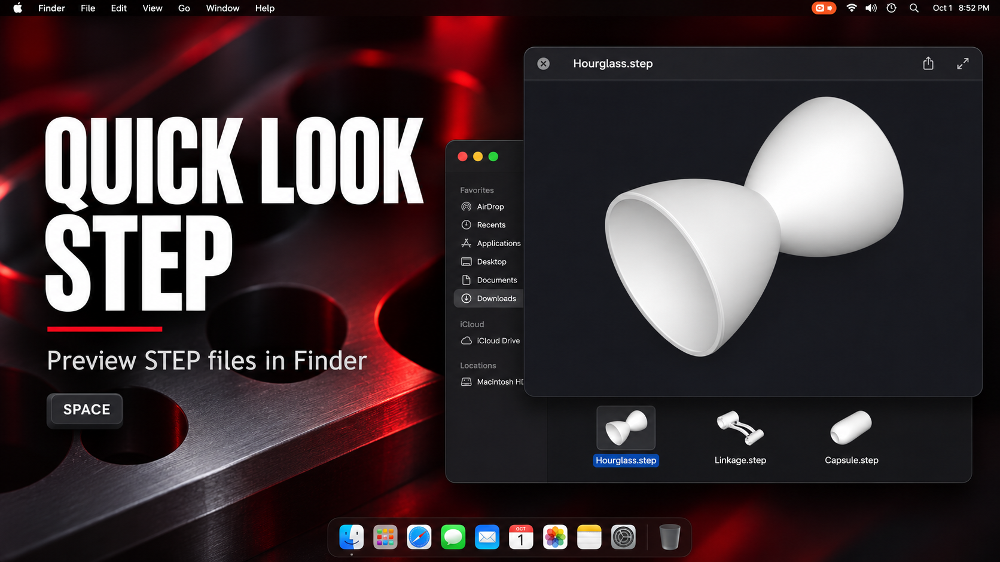

# Quick Look STEP

Preview `.step` and `.stp` models and see their thumbnails in macOS Finder.

[Download for Apple silicon Macs](https://github.com/rdcstout/quick-look-step/releases/latest/download/QuickLookStep-macOS-arm64.dmg) · [Install guide](INSTALL.md)

Originally created by [John Boiles](https://github.com/johnboiles/quick-look-step). This independent fork is maintained by [Extrusion Therapy](https://extrusiontherapy.com).

Open the disk image, drag **Quick Look STEP** to **Applications**, and open it once. Enable the Quick Look extensions in System Settings. Then select a STEP file in Finder and press **Space**. Some complex surfaces can be omitted, and the preview displays a warning when that happens.

[Report an issue](https://github.com/rdcstout/quick-look-step/issues) · [Report a security issue privately](SECURITY.md) · [Build from source](DEVELOPMENT.md) · [Support Future Tools](https://buy.stripe.com/fZu3cw2Mnfr0d7N3ws1kA00)

Quick Look STEP is available under the [MIT License](LICENSE). Its Foxtrot geometry library retains the original [MIT](foxtrot/LICENSE-MIT) and [Apache 2.0](foxtrot/LICENSE-APACHE) texts.
